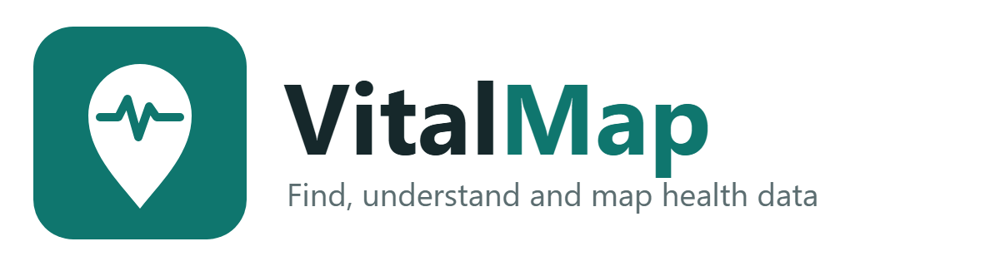

<p align="center">
  <picture>
    <source media="(prefers-color-scheme: dark)" srcset="docs/assets/logo/vitalmap-wordmark-dark.png">
    
  </picture>
</p>

# ai-health-map-project-group-3
### AIHealthMap- AI assisted web mapping application for health data discovery


# Ordnerstruktur für das Repository ist bereits erstellt.

# Einteilung der Aufgaben: 
```
STAC Extensions   <- Emily 
Backend/STAC-API  <- Giang und Paul 
KI-Agent          <- Timo und Lukas 
Frontend          <- Alle können daran am Ende arbeiten
```
## Aufgaben sind eingeteilt, jedoch kann es sich jederzeit leicht ändern.  


**Vorsicht beim Commit!**

Bitte darauf achten, dass auf dem Branch Develop das gesamte Projekt programmiert wird. 
Auf dem main Branch kommt zum Schluss das gesamte Projekt drauf, nachdem es im develop Branch getestet wurde und einwandfrei läuft. 

Daher wäre es am besten, wenn auf dem main Branch nur stabile Versionen landen, sowie auch die Präsentationen und schließlich auch die Abgaben.

## Es gibt eine individuelle Branch Struktur, die sich auf die Aufgabenbereiche verteilt: 
```
feature/stac-extensions

feature/catalog-backend

feature/search-agent

feature/agent-intelligence

feature/frontend
```

## wichtige Command Prompt Befehle
hier sind ein paar wichtige Command Prompt Befehle aufgelistet:
```
git clone git@github.com:.....     # klont Repository lokal auf den Rechner
git checkout -b feature/<branch>   # man wechselt auf ein Branch
git branch                         # sagt, auf welchem Branch man sich zurzeit befindet
git pull origin <branch>           # aktualisiert deinen lokalen Repository mit den Änderungen im Branch und zeigt Veränderungen an
git push -u origin <branch>        # pushed ein neuen Branch unterwürfig dem genannten Branch

git add *                          # fügt alle veränderte Dateien dem Branch hinzu
git status                         # zeigt, welche Dateien verändert werden
git commit -m "<message>"          # legt die Veränderungen nach git add * fest
git push origin <branch>           # pushed die Veränderungen in den Branch im GitHub Repo. 


```

Darin kann jeder in seinem eigenen Bereich arbeiten und nachvollziehbar verstehen, zu welchem Aufgabentyp der Commit/Merge beigetragen hat. 

## Issues (optional)
Die Issues werden später noch ergänzt. Am besten macht es jeder für die riesige Aufgabe, die man sich vorgenommen hat, damit es wie eine To-Do Liste abgearbeitet wird. Z.B. das Aufsetzen von Docker oder sowas.


